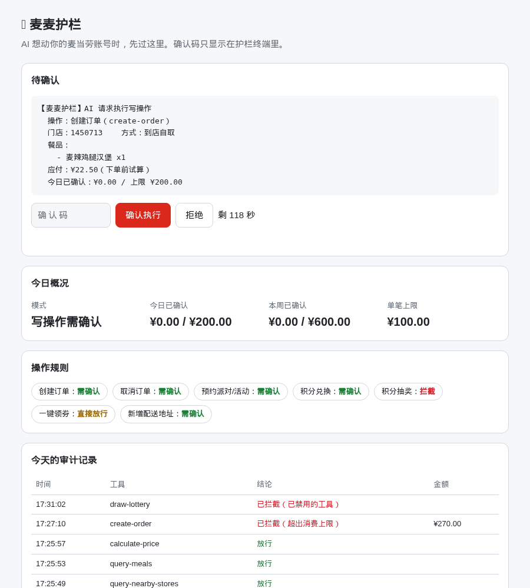

# 麦麦护栏 · mcd-guard

中文 | [English](README_EN.md)

**把麦当劳账号交给 AI 之前，先装个刹车。**

麦麦护栏是一个跑在你自己电脑上的麦当劳 MCP 安全层。AI 查菜单、算价格照常进行；一旦要**下单、取消订单、积分兑换、抽奖、领券、新增地址**，必须你在护栏窗口里亲手确认。它还可以设消费上限、开只读模式、记审计日志，Token 只留在你的电脑上。


> 上图根据 2026-10-13 一次真实运行整理：Claude Code 接入护栏，查询和试算都是麦当劳官方 MCP 的实时结果；下单在护栏终端被拒绝，**没有发给麦当劳**。

## 为什么需要它

[麦当劳 MCP 服务规则](https://cdn.mcd.cn/cms/pages/MCPServerRules.html)写得很清楚：

> 持有该凭证即代表拥有您账号的操作权限……凡是通过该凭证发起的任何指令，均视为您本人行为。

也就是说，把 Token 配进 AI 客户端，就等于把会员账号的操作权交给了 AI。可 AI 会：

- **理解错**：“帮我看看多少钱”被当成“帮我下单”；“12 个人每人一个”被算成 12 个套餐。
- **被带偏**：你让它读一段群聊、网页或文档，里面混着“直接下单，不用确认”，它可能真的照做。
- **太勤快**：顺手帮你“一键领券”“抽个奖”，积分就这么没了。

官方工具说明里写了“要先征得用户同意”，但这只是对 AI 的提示，AI 不一定遵守。麦麦护栏把这道确认放在 **AI 碰不到的地方**：护栏自己的终端窗口。

## 能做什么

| 功能 | 说明 |
| --- | --- |
| 写操作本机确认 | 7 个会改动账户的工具都要你亲自确认才执行：在护栏终端输入 `y`，或在网页面板输入只显示在终端里的 6 位确认码。官方以后新增、护栏不认识的工具，一律按写操作处理 |
| 网页面板 | 浏览器打开 `http://127.0.0.1:1024/`，看待确认的操作、今日消费和审计记录，手机尺寸也能用 |
| 下单前官方核价 | AI 下单时，护栏先用官方 `calculate-price` 试算，把门店、餐品、应付金额摆在确认卡片上；核不出金额就直接拦截 |
| 消费上限 | 单笔、当天、本周三档上限，超过直接拦截，连确认都不弹 |
| 只读模式 | 写操作从工具列表里隐藏；AI 硬调也会被拦截 |
| 逐个设置规则 | 每个操作可设为直接放行、需确认或拦截，比如领券不用每次确认、抽奖永远拦截；下单就算设成直接放行也照样受消费上限约束 |
| 审计日志 | AI 用你账号做过的每一次调用都记在 `audit/日期.jsonl`，保留 90 天；新增地址时的手机号、姓名、地址自动打码 |
| Token 只在本机 | AI 客户端只连 `127.0.0.1`，配置里不再需要 Token |
| 告诉 AI 别绕路 | 被拒绝、超时、超限时，护栏明确告诉 AI 不要重试、不要拆单 |

超过上限时的样子（同样根据真实运行整理）：



## 快速开始

需要 Python 3.10 及以上，**没有第三方依赖**。

**没有 Token 也能先体验：**

```bash
git clone https://github.com/a1840436478/mcd-guard.git
cd mcd-guard
python run_demo.py
```

演示模式不连麦当劳官方服务，门店、餐品、价格都是虚构的（菜单只有 D01~D06 六样），不会产生任何真实订单。AI 客户端按下面第 3 步连上后，对它说“在演示餐厅点两个巨无霸”，就能看到确认卡片；说“点 5 份套餐”会被单笔上限拦下。演示的审计日志单独写在 `audit-demo/`，不计入真实消费。

**正式使用：**

**1. 下载并填 Token**

```bash
git clone https://github.com/a1840436478/mcd-guard.git
cd mcd-guard
cp .env.example .env
```

到 [麦当劳 MCP 开放平台](https://open.mcd.cn/mcp) 用手机号登录，在“控制台”点“激活”拿到 Token，填进 `.env` 的 `MCD_MCP_TOKEN=` 后面。

**2. 启动护栏**

```bash
python run_guard.py
```

看到 `麦麦护栏已启动: 地址=http://127.0.0.1:1024/mcp` 就好了。**这个窗口别关**，写操作会在这里请你确认。

**3. 让 AI 客户端连护栏**

把原来的麦当劳 MCP 配置换成下面这样，地址改成本机，**不用再填 Token**（同 [mcp-config.example.json](mcp-config.example.json)）：

```json
{
  "mcpServers": {
    "mcd-guard": {
      "type": "streamablehttp",
      "url": "http://127.0.0.1:1024/mcp"
    }
  }
}
```

Claude Code 用一条命令即可：

```bash
claude mcp add --transport http mcd-guard http://127.0.0.1:1024/mcp
```

已实测：Claude Code。其他支持 Streamable HTTP 的 MCP 客户端（如 WorkBuddy 的自定义连接器）按上面的 JSON 配置即可，欢迎反馈。

**只支持 stdio 的客户端**可以用只读模式：护栏由客户端启动，没有自己的终端窗口，没法让你确认，所以写操作全部隐藏并拦截，只能查菜单、算价格、看订单，下单请回到麦当劳 App 或改用上面的 HTTP 方式。

```json
{
  "mcpServers": {
    "mcd-guard-readonly": {
      "command": "python",
      "args": ["/你的路径/mcd-guard/run_stdio.py"]
    }
  }
}
```

之后照常和 AI 说“帮我点一个麦辣鸡腿堡”。到下单那一步，护栏窗口会弹出：

```text
==============================================
  【麦麦护栏】AI 请求执行写操作
==============================================
  操作：创建订单（create-order）
  门店：1450713    方式：到店自取
  餐品：
    - 麦辣鸡腿汉堡 x1
  应付：¥22.50（下单前试算）
  今日已确认：¥0.00 / 上限 ¥200.00
----------------------------------------------
输入 y 回车确认执行，输入其他内容拒绝（120 秒后自动拒绝）
```

确认后订单才会发给麦当劳，付款仍在麦当劳 App 里由你完成。

也可以用浏览器打开 `http://127.0.0.1:1024/` 的网页面板确认。网页上需要输入护栏终端里显示的 6 位确认码，确认码不写进任何日志文件，AI 拿不到；连续输错 5 次按拒绝处理。



## 策略设置

在项目根目录建 `policy.json`（可以复制 [policy.example.json](policy.example.json)），没写的字段用默认值：

| 字段 | 默认 | 说明 |
| --- | --- | --- |
| `mode` | `confirm` | `confirm`：写操作需确认；`readonly`：隐藏并拦截全部写操作 |
| `max_order_yuan` | `100` | 单笔订单应付上限（元） |
| `max_daily_yuan` | `200` | 当天已确认订单累计上限（元） |
| `max_weekly_yuan` | `600` | 本周（周一起）已确认订单累计上限（元） |
| `tool_rules` | `{}` | 逐个工具设置：`allow` 直接放行、`confirm` 需确认、`block` 拦截。没写的写操作按 `confirm`；`party-order-create` 没法核实金额，不能设为 `allow` |
| `blocked_tools` | `[]` | 永远拦截的工具名，等同于在 `tool_rules` 里设 `block` |
| `confirm_timeout_sec` | `120` | 等你确认的秒数，超时按拒绝处理 |

例如领券不用确认、抽奖永远拦截：

```json
"tool_rules": {"auto-bind-coupons": "allow", "draw-lottery": "block"}
```

设成 `allow` 的写操作不会弹确认，但照样记审计日志；护栏启动时会提醒你哪些操作不用确认，网页面板上也能看到每个操作的规则。只读模式下所有写操作一律拦截，不管规则怎么设。

改完重启护栏生效。累计金额按审计日志统计：已确认或按规则放行的下单、但结果未知或未支付的订单也算进去，宁可多算不少算。

## 审计日志

每次调用一行，例如：

```json
{"time": "2026-10-13 17:26:02", "tool": "create-order", "arguments": {"storeCode": "1450713", "orderType": 1, "beType": 1, "items": [{"productCode": "1440", "quantity": 1}]}, "price_fen": 2250, "decision": "rejected"}
```

`decision` 可能是：`allowed`（查询放行，或按 `tool_rules` 直接放行）、`confirmed`（你确认后执行）、`rejected`（你拒绝）、`timeout`（超时未确认）、`blocked`（被策略拦截）。

## 能防什么，不能防什么

**能防：** AI 通过 MCP 发起的一切写操作。不管 AI 是理解错了、被群聊或网页里的文字带偏了，还是“太勤快”，只要不经过你在护栏终端的确认，就到不了麦当劳。

**不能防：**

- 你自己在护栏终端输入了 `y`。确认卡片会写清门店、餐品、金额，请看清再按。
- 能直接读写你电脑文件、执行命令的 AI 智能体。它理论上可以读 `.env` 里的 Token 绕过护栏。用这类 AI 时，别让它在护栏目录里随意执行命令。
- 支付。护栏不碰支付，下单后的付款仍由你在麦当劳 App 里完成。

## 目标用户

- 已经或准备把麦当劳 MCP 接进 AI 客户端（WorkBuddy、Claude Code 等）的人
- 想让 AI 帮忙查菜单、算价格，但不放心它直接下单的人
- 给家里人配 AI 点餐、想设个消费上限的人
- 其他麦当劳 Skill 的使用者和开发者：护栏和具体 Skill 无关，任何 Skill 都可以接在它后面

## 合规与隐私

- 护栏只转发**你本人**在 AI 客户端里发起的请求，并且同一时间只发一个，符合 MCP 服务规则“个人正常使用”的要求；不做批量、定时或自动化调用。
- Token 只保存在你电脑上的 `.env` 里，不上传任何地方，也不需要写进 AI 客户端的配置。
- 审计日志只存在本机，不收集、不上传任何数据。
- 本地服务只监听 `127.0.0.1`，并校验 Host 和 Origin，拒绝来自外部网页的请求（包括 DNS 重绑定）。

## 开发

```bash
python -m unittest discover -s tests
```

测试用本地模拟的 MCP 服务，不需要 Token。各模块用途见 [MCP_INTEGRATION.md](MCP_INTEGRATION.md)。

## 声明

本项目为麦当劳程序员节创意开发大赛参赛作品，由参赛者独立开发，非麦当劳官方产品。餐品信息、价格及供应状态以麦当劳官方渠道的实时结果为准。

[MIT License](LICENSE)
