# mcd-guard · 麦麦护栏

[中文](README.md) | English

**Put a brake on your AI before handing it your McDonald's account.**

mcd-guard is a local, human-in-the-loop safety proxy for the official [McDonald's China MCP server](https://open.mcd.cn/mcp). It sits between your AI client and `https://mcp.mcd.cn`: read-only tools (menus, stores, price quotes) pass straight through, while every tool that changes your account — placing or cancelling orders, redeeming points, lottery draws, claiming coupons, adding addresses — must be approved by you, outside the AI's reach.



## Why

The official MCP service rules state that holding the token means holding full operating rights to your account, and every instruction sent with it counts as your own action. An AI agent can misunderstand ("how much would it cost" → places the order), be steered by prompt injection hidden in a group chat or web page, or simply be over-eager. Tool descriptions ask the model to get user consent first, but that is only a hint the model may ignore. mcd-guard enforces the consent step in a place the AI cannot touch: the guard's own terminal.

## Features

| Feature | Details |
| --- | --- |
| Human confirmation for writes | All 7 write tools require you to type `y` in the guard terminal, or enter a 6-digit code (shown only in the terminal) in the local web panel. Unknown tools added later are treated as writes (fail-safe) |
| Official price check | Before `create-order`, the guard calls the official `calculate-price` and shows store, items and amount on the confirmation card; if the price can't be verified, the order is blocked |
| Spending limits | Per-order, daily and weekly caps; over-limit orders are blocked without even asking |
| Read-only mode | Write tools are hidden from the tool list and blocked if called anyway |
| Per-tool rules | Set each tool to `allow` (no confirmation), `confirm` or `block`, e.g. `"tool_rules": {"auto-bind-coupons": "allow", "draw-lottery": "block"}`. Orders set to `allow` are still subject to spending limits |
| Audit log | Every call is logged to `audit/DATE.jsonl` (kept 90 days), with phone numbers, names and addresses redacted |
| Token stays local | AI clients connect to `127.0.0.1` and no longer need the token |
| Web panel | `http://127.0.0.1:1024/` shows pending requests, today's spending and the audit log; Host/Origin checks block DNS rebinding |
| No retry hints | On reject, timeout or over-limit, the guard tells the AI not to retry or split the order |

Pure Python standard library, zero dependencies, 53 unit tests.

## Quick start

Requires Python 3.10+.

**Try it without a token** (demo mode, fictional store and menu, never contacts McDonald's):

```bash
git clone https://github.com/a1840436478/mcd-guard.git
cd mcd-guard
python run_demo.py
```

**Real use:** copy `.env.example` to `.env`, put your token from the [McDonald's MCP platform](https://open.mcd.cn/mcp) after `MCD_MCP_TOKEN=`, then run `python run_guard.py` and keep that terminal open.

Point your AI client at the guard instead of the official server (no token needed):

```json
{
  "mcpServers": {
    "mcd-guard": {
      "type": "streamablehttp",
      "url": "http://127.0.0.1:1024/mcp"
    }
  }
}
```

For Claude Code: `claude mcp add --transport http mcd-guard http://127.0.0.1:1024/mcp`

stdio-only clients can launch `python run_stdio.py` instead. With no terminal to confirm in, it runs read-only: write tools are hidden and blocked.

Policy (`policy.json`, see [policy.example.json](policy.example.json)): `mode` (`confirm` / `readonly`), `max_order_yuan`, `max_daily_yuan`, `max_weekly_yuan`, `tool_rules`, `blocked_tools`, `confirm_timeout_sec`.

## Threat model

**Protects against:** any write operation an AI attempts through MCP — misunderstanding, prompt injection, or over-eagerness — unless you approve it in the guard terminal.

**Does not protect against:** you approving it yourself; AI agents that can read your files or run shell commands (they could read the token from `.env` — don't let them run commands in the guard's directory); payment (orders are still paid by you in the McDonald's app).

## Notes

An entry for the McDonald's China Programmer's Day Developer Challenge. Independent project, not an official McDonald's product. Personal, non-commercial use only, per the MCP service rules. [MIT License](LICENSE)
